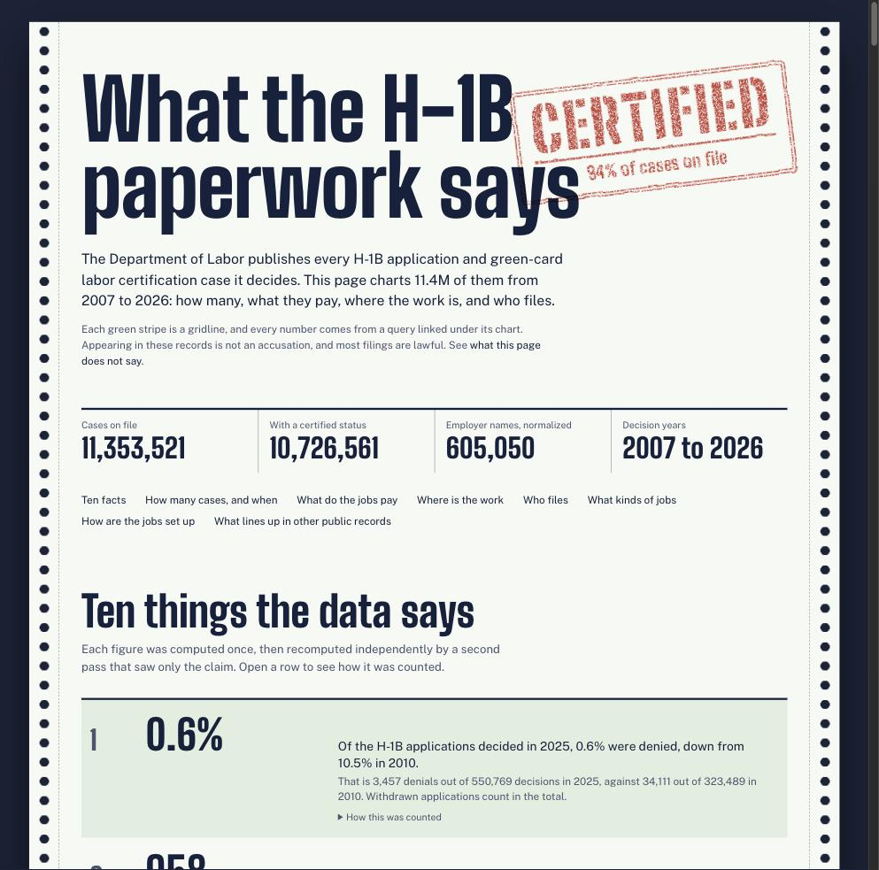

# What the H-1B paperwork says

An infographic site built from the U.S. Department of Labor's public H-1B and PERM disclosure files: about 11.4 million cases,
charted by year, wage, place, employer and occupation, with ten verified facts up top.

The look is a green-bar printout: the alternating stripes are the gridlines.



## Run it

```sh
npm install
npm run dev          # http://localhost:3000
npm run build        # static site in out/
```

The site is fully static. To host under a sub-path (GitHub Pages), build with `NEXT_PUBLIC_BASE_PATH=/your-repo-name`.

## Where the numbers come from

Every number is computed by a DuckDB query in [`queries/`](queries) over a local copy of public records, and the aggregated result
is committed in [`src/data/`](src/data). The site builds without the source data. To regenerate a chart:

```sh
brew install duckdb                       # or see duckdb.org
export H1B_DATA_DIR=/path/to/dataset      # folder containing LCA-PERM/, SBA/, FUEL-PUMPS/, STAFFING-MAJORS/
node scripts/run-query.mjs certified-per-year
```

The source records are published by the [Department of Labor](https://www.dol.gov/agencies/eta/foreign-labor/performance),
the [Small Business Administration](https://data.sba.gov/dataset/ppp-foia) and the [EPA](https://www.epa.gov/ust).
They were compiled into one research dataset of Parquet files; `LCA-PERM/filing_current` is the spine.

Read [`docs/CHART-GUIDE.md`](docs/CHART-GUIDE.md) for the data rules every chart follows (calendar years, what counts as certified,
blank versus zero, state normalization, wage annualization).

## How it is organized

| Path | What |
|---|---|
| `queries/<id>.sql` | one query per chart |
| `queries/facts/<id>.sql` | one query per fact on the facts page |
| `src/data/<id>.json` | the query result the chart renders |
| `src/charts/<id>.tsx` | the chart: `meta`, a computed `takeaway`, and the component |
| `facts/config.json` | wording templates for the ten facts; numbers are filled from query results |
| `scripts/` | `run-query`, `check-chart`, `gen-registry`, `build-facts`, `verify-facts`, `audit` |

```sh
node scripts/gen-registry.mjs      # rebuild the chart index after adding a chart
npx tsx scripts/check-chart.mts <id>   # typecheck and render one chart in jsdom
node scripts/verify-facts.mjs      # re-run every fact query against the dataset
node scripts/audit.mjs             # scan for personal data and accusatory wording
```

## What this does not say

Appearing in these records is not an accusation, and everyone named is presumed to have followed the law. Most applications are
lawful. A match between two datasets shows an apparent data relationship, not a finding of fact. Counts of applications are not counts
of workers or visas. The records can contain errors carried over from the original files. Nothing here is legal advice, and none of it
should be used to make decisions about any person.

The repository holds aggregates only: no names, emails, phone numbers or street addresses.

## License

Code is MIT licensed. The underlying records are U.S. government works and facts from public records.
